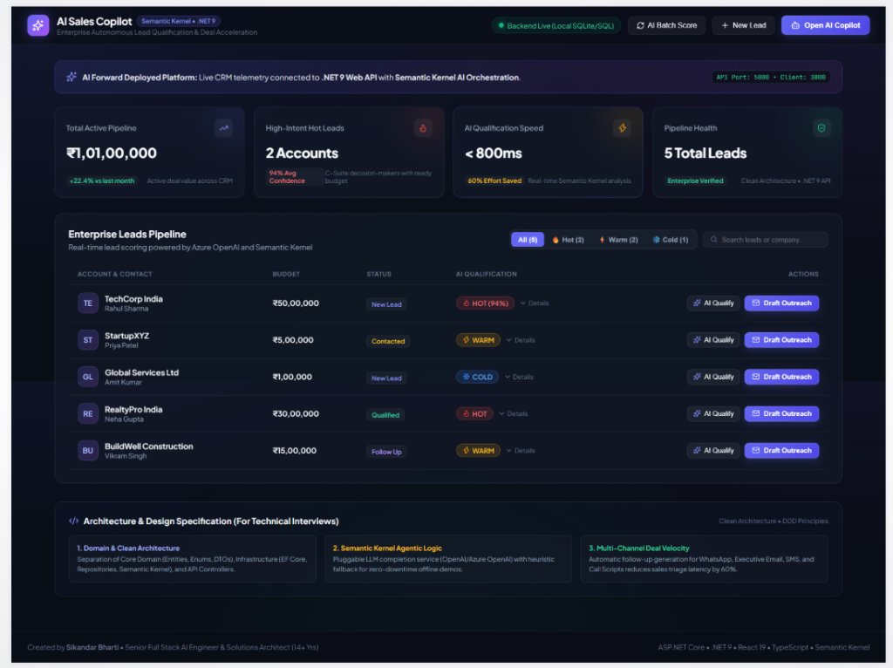

# 🤖 AI Sales Copilot

[](https://dotnet.microsoft.com)
[](https://react.dev)
[](https://learn.microsoft.com/semantic-kernel)
[](https://typescriptlang.org)
[](LICENSE)

> **Production-Grade Enterprise Sales Intelligence Platform** built with **.NET 9 Clean Architecture, Microsoft Semantic Kernel, Azure OpenAI, React 19 & TypeScript**.

Developed by **Sikandar Bharti** — Senior Full Stack AI Engineer & Solutions Architect • 14+ Years Enterprise Experience.



---

## ⚡ Quick Start (One Command)

```bash
# Prerequisites: .NET 9 SDK + Node.js 18+
git clone https://github.com/SBharti1983/ai-sales-copilot.git
cd ai-sales-copilot
```

**Windows (double-click):** `start-demo.bat`

**PowerShell:**
```powershell
.\start-demo.ps1
```

Browser opens automatically at **`http://localhost:3000`** — Backend API runs on `http://127.0.0.1:5000`

> **No database setup needed** — uses SQLite by default with 5 seeded enterprise accounts.
> **No API key needed** — AI features work offline via intelligent heuristic engine.

---

## 💎 Key Features

| Capability | Technical Implementation | Business Impact |
|---|---|---|
| **🧠 AI Lead Qualification** | Semantic Kernel + Azure OpenAI `gpt-4o-mini` with heuristic fallback | Scores enterprise leads by authority, budget & urgency in <800ms |
| **💬 Conversational AI Copilot** | Side-docked chat with intent detection & context injection | Real-time pipeline queries and strategic deal recommendations |
| **📨 Multi-Channel Outreach** | WhatsApp, Email, SMS & Call Script generation | 60% faster sales follow-up with personalized value propositions |
| **📊 Live CRM Telemetry** | EF Core 9 with dual SQLite/SQL Server support | Aggregates ₹1Cr+ pipeline, deal velocity & conversion probability |
| **🏗️ Clean Architecture & DDD** | Core → Infrastructure → API strict layer separation | Enterprise-grade maintainability & pluggable service providers |

---

## 🏗️ System Architecture

```
┌──────────────────────────────────────────────────────────┐
│                React 19 + TypeScript UI                   │
│          Vite • Dark Glassmorphism • Lucide Icons         │
└─────────────────────────┬────────────────────────────────┘
                          │ REST APIs / JSON
┌─────────────────────────▼────────────────────────────────┐
│                 .NET 9 Web API Layer                      │
│        Controllers • OpenAPI • CORS • Validation         │
└───────────┬─────────────────────────────────┬────────────┘
            │                                 │
┌───────────▼───────────────┐   ┌─────────────▼────────────┐
│  Infrastructure / EF Core  │   │  Semantic Kernel Engine  │
│   Repositories • SQLite    │   │  Azure OpenAI • LLM      │
└───────────┬───────────────┘   └─────────────┬────────────┘
            │                                 │
┌───────────▼───────────────┐   ┌─────────────▼────────────┐
│      CRM Data Layer       │   │  Heuristic Fallback      │
│  Leads, FollowUps, Conv   │   │  Zero-Failure Offline    │
└───────────────────────────┘   └──────────────────────────┘
```

---

## 📂 Project Structure (Clean Architecture)

```
AISalesCopilot/
├── AISalesCopilot.Core/           # Domain Layer (Zero Dependencies)
│   ├── Entities/                  # Lead, Conversation, FollowUp
│   ├── DTOs/                      # LeadDto, DashboardDto, ChatDto
│   ├── Enums/                     # LeadStatus, AiQualification, Channel
│   └── Interfaces/                # ILeadRepository, IAiService
│
├── AISalesCopilot.Infrastructure/ # Infrastructure Layer
│   ├── Data/                      # EF Core DbContext + Seed Data
│   ├── Repositories/              # Repository Pattern Implementation
│   └── Services/                  # AiService (Semantic Kernel + Fallback)
│
├── AISalesCopilot.API/            # Presentation Layer
│   ├── Controllers/               # LeadsController (13 REST endpoints)
│   └── Program.cs                 # DI Container + Middleware Pipeline
│
├── client/                        # React 19 Frontend
│   ├── src/components/            # Dashboard, LeadTable, Chat, Modals
│   ├── src/services/              # API Client Layer
│   └── src/types/                 # TypeScript Interfaces
│
├── start-demo.bat                 # 1-Click Demo Launcher
├── start-demo.ps1                 # PowerShell Orchestrator
└── README.md
```

---

## 🔌 API Endpoints (13 REST APIs)

| Method | Endpoint | Description |
|--------|----------|-------------|
| `GET` | `/api/leads` | Get all leads with AI scores |
| `GET` | `/api/leads/{id}` | Get lead by ID |
| `POST` | `/api/leads` | Create new enterprise lead |
| `PUT` | `/api/leads/{id}` | Update lead details |
| `DELETE` | `/api/leads/{id}` | Remove lead |
| `POST` | `/api/leads/{id}/qualify` | AI-qualify single lead |
| `POST` | `/api/leads/batch-qualify` | AI-qualify all leads |
| `POST` | `/api/leads/chat` | Conversational AI copilot |
| `GET` | `/api/leads/dashboard` | Pipeline analytics & KPIs |
| `POST` | `/api/leads/{id}/followup` | Generate multi-channel outreach |
| `GET` | `/api/leads/{id}/followups` | Get all follow-ups for lead |
| `PUT` | `/api/leads/followup/{id}/send` | Mark follow-up as sent |
| `GET` | `/api/leads/health` | API health check |

---

## 🎥 Interview Demo Script (5 Minutes)

### 1️⃣ The Executive Pitch (30 sec)
> *"In enterprise CRM, sales reps lose up to 60% of their time manually reviewing inquiries. I built AI Sales Copilot to bridge raw enterprise data with autonomous AI decision-making using .NET 9 Clean Architecture and Microsoft Semantic Kernel."*

### 2️⃣ Live Dashboard (1 min)
> Show the ₹1.01 Crore pipeline, 5 enterprise accounts, HOT/WARM/COLD AI scores.

### 3️⃣ Interactive AI (1.5 min)
- Click **"AI Qualify"** → Real-time scoring with confidence %
- Click **"Draft Outreach"** → WhatsApp, Email, SMS, Call Script
- Show personalized value propositions per client

### 4️⃣ AI Copilot Chat (1 min)
- Click **"Open AI Copilot"** → Ask: *"Who are my top hot leads?"*
- Show intent detection and CRM data synthesis

### 5️⃣ Code Architecture (1 min)
- Show `Core` → `Infrastructure` → `API` separation
- Highlight DI in `Program.cs` and `AiService.cs` Semantic Kernel integration

---

## 🛠️ Tech Stack

| Layer | Technologies |
|-------|-------------|
| **Backend** | C# • .NET 9 • ASP.NET Core Web API • Entity Framework Core 9 |
| **AI & GenAI** | Microsoft Semantic Kernel 1.54 • Azure OpenAI / OpenAI API • Prompt Engineering |
| **Database** | SQLite (default) • SQL Server (configurable) |
| **Frontend** | React 19 • TypeScript • Vite • Lucide Icons • Glassmorphism CSS |
| **Architecture** | Clean Architecture • DDD • Repository Pattern • SOLID Principles |

---

## 🔧 Configuration

To enable live AI responses (optional), add your OpenAI key in `AISalesCopilot.API/appsettings.json`:

```json
{
  "OpenAI": {
    "ApiKey": "sk-your-key-here",
    "ModelId": "gpt-4o-mini"
  }
}
```

Without an API key, the system uses an intelligent heuristic engine — **zero-downtime offline demos**.

---

## 📜 License

MIT License — free to use, modify, and distribute.

---

**Built with ❤️ by [Sikandar Bharti](https://linkedin.com/in/YOUR_LINKEDIN) — Senior Full Stack AI Engineer & Solutions Architect**
